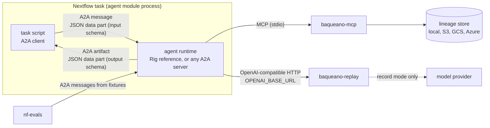

# Architecture

## The problem

AI agents are starting to run inside scientific pipelines. They write methods sections, review QC reports and triage failed runs. Pipeline steps have requirements that chat assistants do not:

- **Provenance.** Every answer has to trace back to the run, the inputs, the tool versions and the exact model exchanges that produced it.
- **Evals.** A step that calls a model needs a measured pass rate on labelled cases before anyone trusts it.
- **Determinism in tests.** CI has to exercise agent steps without API keys, network access or spend.
- **Data residency.** Inputs, outputs, logs and telemetry stay in the user's own cloud account.

baqueano provides the contracts and tools for this in Nextflow, compatible with nf-core.

## Layers

1. **Lineage and tools (Rust).**
   - `baqueano-lineage` reads Nextflow's data lineage store from local disk or object storage. It provides `find`, `check`, a semantic `diff` and `provenance`.
   - `baqueano-mcp` exposes those operations to any agent as read-only MCP tools.
   - `baqueano-replay` records and replays model traffic.
   - `nf-evals` scores agents against labelled cases.
2. **Agent modules (Nextflow).** Each module, such as `RUN_METHODS` or `QC_REVIEW`, is an nf-core-compatible `process` that runs an agent and writes typed JSON plus optional files. Each one ships with JSON Schemas and evals.
3. **Infrastructure (OpenTofu).** A compute contract that every cloud target implements, hardened profiles and evidence packs. AWS is the first target.

## Agent architecture

Agents speak an open protocol at the boundary between module and runtime. Tools and models sit behind boundaries that every framework already supports.

**Module ↔ runtime: A2A.** Modules talk to agents over [A2A (Agent2Agent)](https://a2a-protocol.org/), a Linux Foundation protocol. The target is **v1.0**, and **v0.3** is accepted as a compatibility profile because several frameworks still ship v0.3 servers. A2A is task-oriented, which fits a pipeline step:

- an Agent Card declares skills and their input and output media types;
- a Task carries text, JSON data and file parts;
- results come back as Artifacts, with explicit states such as `completed`, `failed` and `input-required`.

A module is a plain `process` whose container is an A2A runtime image. The task script starts the server on `127.0.0.1:${A2A_PORT}`, waits for `/.well-known/agent-card.json`, sends one message with the task inputs as a JSON data part, writes the returned artifact to disk and stops the server. With `params.agent_url` set, the same module calls a remote A2A agent instead. The real portability contract is the module's input and output **JSON Schemas**, kept in the module next to `meta.yml`. Evals check against them.

**Reference runtime: Rig.** The reference image, `baqueano-runtime`, is a small Rust binary:

- a [Rig](https://github.com/0xPlaygrounds/rig) agent;
- `rig-rmcp` to reach `baqueano-mcp`;
- `rig-a2a` to serve A2A v1.0 at the root and v0.3 at `/v03`, with the output schema published on the card.

Rust was chosen because each Nextflow task starts its own container, often hundreds at once in a wide `map` step. Start-up time and memory per task therefore count. `rig-a2a` is a community crate and is not part of Rig upstream.

**Any A2A framework can serve a module.** A Strands Agents image (Python or TypeScript), or a LangGraph, Google ADK, CrewAI or BeeAI agent with an A2A server, can serve the same module. It has to honour the module's JSON Schemas, read `OPENAI_BASE_URL` and use `baqueano-mcp` for lineage. Swap the module's `container`, or point `params.agent_url` at it.

**Tools: MCP.** `baqueano-mcp` is the single, framework-neutral source of lineage tools. Rig, Strands, Claude Code, editors and other MCP clients all reach it the same way. The targets are MCP 2025-11-25 and 2026-07-28.

**Model edge: OpenAI-compatible HTTP.** Every runtime reads its model endpoint from `OPENAI_BASE_URL`. In tests that endpoint is `baqueano-replay`, which replays recorded responses byte for byte, SSE included. Replay therefore works the same for Rig, for Strands and for Nextflow's own `agent` primitive (`agent.baseUrl`). A request with no recording fails loudly with HTTP 599 and never reaches the network.

**Evals** send A2A messages built from fixtures and score the returned artifact against the output schema, using deterministic graders and an LLM judge. Every module has a pass threshold, and the eval run has a spend cap.

**Provenance.** Nextflow lineage records each task's inputs, container digest and outputs. Module output also carries the A2A `taskId`, the `contextId` and the cassette ID. With those, `baqueano-mcp provenance` can tie an answer to the run that produced it and to its exact model exchanges.

### Nextflow's `agent` primitive

Nextflow 26.10 ships an `agent` primitive as a **preview** feature. Its runners and internal protocol are still changing, and its only external interface is the OpenAI wire protocol via `agent.baseUrl`. baqueano supports it as a consumer:

- point `agent.baseUrl` at `baqueano-replay` for deterministic tests;
- read the `AgentRun` lineage records it writes with `baqueano-lineage`.

It is not the module contract. A runner plugin that forwards the primitive to an A2A agent is a possible later addition.

### Alternatives considered

| Option | Why not as the module boundary |
| --- | --- |
| Agent Client Protocol | Standardizes editor ↔ coding agent, with interactive sessions over stdio. That is the wrong shape for a batch step with typed inputs and outputs. It may serve later as a developer front. |
| IBM Agent Communication Protocol | Archived; merged into A2A under the Linux Foundation in 2025. |
| MCP as the agent boundary | Conflates the tool layer with the agent layer. Long-running agent tasks are better served by A2A tasks. |
| OpenAI-compatible "agent as a model" facade | Hides tool traces, nests one agent loop inside another, and is not an agent protocol. |

## Principles

- **Contracts first.** Schemas, traits and interfaces come before implementations.
- **Tests need no card and no API key.** The PR suite runs with Docker only. Real models and real clouds run in separate scheduled jobs.
- **Read-only by default.** Lineage tools and agents do not modify data or infrastructure.
- **Data stays in the user's account.** That covers infrastructure, telemetry and evals. There is no third-party telemetry by default.
- **No clinical claims.** Everything generated is research material and says so.
- **Every agent module ships evals with a threshold.**
- **nf-core compatible.** Modules follow nf-core module layout and conventions, and are tested with nf-test.
- **Cloud-agnostic.** No core crate or module depends on a single provider. Storage goes through `object_store`, and compute goes through the compute contract.
- **Tolerant of experimental formats.** Lineage is `v1beta1`. The parser accepts unknown fields and record kinds, and fails with clear errors, never panics.

## Status

| Component | Status |
| --- | --- |
| Lineage fixtures (Nextflow 25.04.8, 25.10.9, 26.04.9, 26.10.7, plus an `AgentRun` store) | Implemented, in review |
| `baqueano-lineage`: record model, `LineageStore` on `object_store`, `find`, `check`, semantic `diff` | Implemented, in review |
| `baqueano-lineage`: `view`, `provenance`, CLI contract suite, S3 integration test | In progress |
| `baqueano-replay`: record, replay, passthrough; chat completions, Responses and Messages SSE; Docker image; offline Nextflow test | Implemented, in review |
| `baqueano-mcp` | Planned (v0.1) |
| A2A module contract, `baqueano-runtime`, `RUN_METHODS`, `QC_REVIEW`, `nf-evals` | Planned (v0.2) |
| Compute contract and AWS modules | Planned (v0.4) |

See [ROADMAP.md](../ROADMAP.md) for milestones and acceptance criteria.
